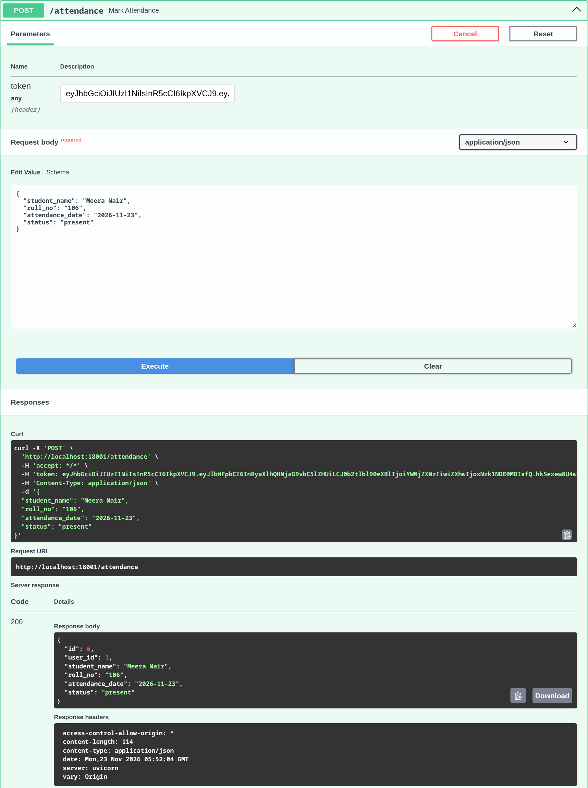
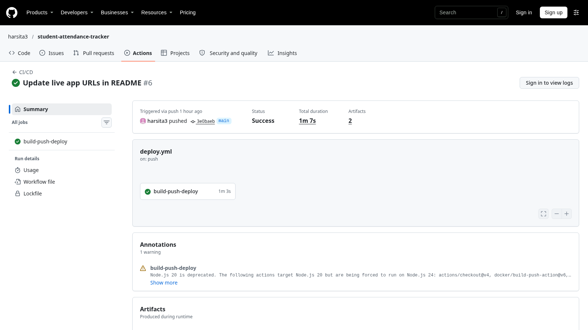

# Student Attendance Tracker

## 1. Project and team

A web app where teachers register, log in, mark students present or absent, and see only the attendance records they created. Built with FastAPI + SQLite (backend) and React (frontend), deployed on AWS EC2 with Docker and GitHub Actions.

| Member | Endpoints built | Other work |
|---|---|---|
| Aryan | A3 `POST /refresh` | `database.py` (tables, engine), `main.py` (all routes, validation, CORS), frontend pages, Docker and CI/CD fixes |
| Rehaan | E1 `GET /attendance`, E2 `POST /attendance` | Dockerfile, frontend project setup |
| Harsita | A1 `POST /register`, A2 `POST /login` | GitHub repo, collaborators, README, frontend register page |

### Work log

| Day | Partner | What was done |
|---|---|---|
| Day 1 | Aryan | `database.py` (engine, tables, JWT config), `requirements.txt`, `.gitignore` |
| Day 1 | Rehaan | E1 (get attendance) and E2 (mark attendance) |
| Day 1 | Harsita | GitHub repo, README, collaborators |
| Day 2 | Aryan | Full `main.py`, A3 (refresh token) |
| Day 2 | Rehaan | Dockerfile, frontend structure |
| Day 2 | Harsita | A1 (register) and A2 (login) with JWT token helpers |
| Day 3 | Aryan | Login and dashboard pages, CORS, status code fixes, CI/CD and EC2 deployment |
| Day 3 | Rehaan | |
| Day 3 | Harsita | Register page |

## 2. Live app

- Frontend: http://13.233.100.147
- API docs: http://13.233.100.147:8001/docs

## 3. How to run it

```bash
git clone https://github.com/harsita3/student-attendance-tracker.git
cd student-attendance-tracker
```

### Backend

```bash
cd BACKEND
python -m venv venv
source venv/bin/activate        # Windows: venv\Scripts\activate
pip install -r requirements.txt
uvicorn main:app --reload --port 8001
```

Open http://127.0.0.1:8001/docs

### Frontend

```bash
cd FRONTEND
npm install
npm run dev
```

Open http://localhost:5173

The backend address is kept in one place, `FRONTEND/src/config.js`. It uses the same host the page was opened from, on port 8001, so it works both locally and on EC2.

### Docker

```bash
cd BACKEND
docker build -t student-attendence .
docker run -d --name attendance-tracker -p 8001:8001 \
  -v ~/attendance-data:/app/data \
  -e DB_URL=sqlite:////app/data/attendance.db \
  student-attendence

cd ../FRONTEND
docker build -t student-attendence-frontend .
docker run -d --name attendance-frontend -p 80:80 student-attendence-frontend
```

Or pull the published images:

```bash
docker pull aryannvrao/student-attendence:latest
docker pull aryannvrao/student-attendence-frontend:latest
```

### CI/CD

Every push to `main` runs `.github/workflows/deploy.yml`: it builds both images, pushes them to Docker Hub, connects to EC2 over SSH, replaces the running containers and starts the new ones. `attendance.db` lives in `~/attendance-data` on EC2 and is mounted into the container, so records survive every redeploy.

GitHub Actions secrets used: `DOCKERHUB_USERNAME`, `DOCKERHUB_TOKEN`, `EC2_HOST`, `EC2_USER`, `EC2_SSH_KEY`, `JWT_SECRET_KEY`.

## 4. API contract

Backend runs on port **8001** with CORS enabled.

| # | What it does | Method | Path | Request body | Success code |
|---|---|---|---|---|---|
| A1 | Register a new teacher | POST | `/register` | `{ username, email, password }` | 200 |
| A2 | Login and generate JWT access and refresh tokens | POST | `/login` | `{ email, password }` | 200 |
| A3 | Generate a new access token using a refresh token | POST | `/refresh` | — (refresh token in `refresh_token` header) | 200 |
| E1 | Get all attendance records created by the logged-in teacher | GET | `/attendance` | — (access token in `token` header) | 200 |
| E2 | Mark a student's attendance for the logged-in teacher | POST | `/attendance` | `{ student_name, roll_no, attendance_date, status }` + access token in `token` header | 200 |

### Error rules

| Rule | Status | Message |
|---|---|---|
| Registering with an email that already exists | 409 | `Email already registered` |
| Logging in with incorrect email or password | 401 | `Invalid email or password` |
| Using an invalid or expired access token | 401 | `Invalid or Expired token` |
| Using an invalid or expired refresh token | 401 | `Invalid or Expired refresh token` |
| Accessing attendance records without authentication | 401 | `Invalid or Expired token` |
| Sending missing or empty required fields | 422 | e.g. `Student name cannot be empty` |
| Registering with an invalid email format | 422 | `Invalid email format` |
| Providing a status other than present or absent | 422 | `Status must be one of ['present', 'absent']` |

## 5. Database

One SQLite file, `attendance.db`, with two tables.

| Table | Columns |
|---|---|
| `users` | `id`, `username`, `email` (unique), `hashed_password` (argon2), `created_at` |
| `attendance` | `id`, `user_id` (→ `users.id`), `student_name`, `roll_no`, `attendance_date`, `status` (`present` / `absent`), `created_at` |

## 6. Screenshots


Registering a new teacher.


Logging in with email and password.


Dashboard loading the teacher's attendance records automatically after login.


Error shown on screen when registering with an email that already exists (409).


Marking attendance through `POST /attendance` in Swagger UI.


Green GitHub Actions run that built, pushed and deployed the app.

## 7. Known issues

- Marking attendance is done through `/docs`; the frontend only shows records (no mark-attendance form yet).
- Records cannot be edited or deleted.
- Tokens are stored in `localStorage`, and logout does not invalidate the refresh token on the server.
- The app runs over plain HTTP, not HTTPS.

With more time we would add a mark-attendance form on the dashboard, edit/delete for records, filtering by date or student, and HTTPS with a domain name.
